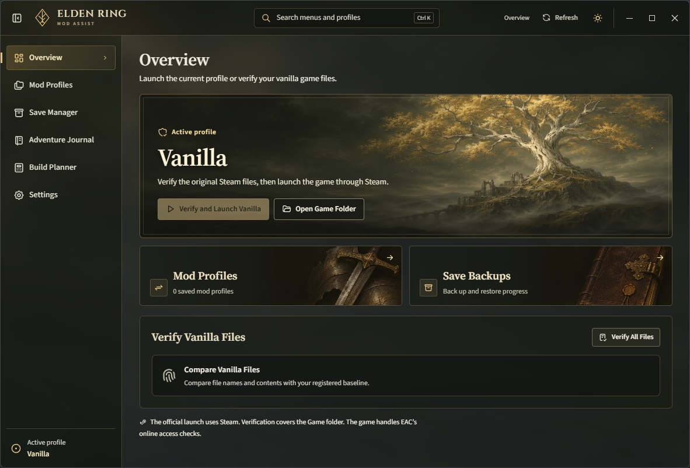

# Elden Ring Mod Assist · Erdtree

Steam판 **ELDEN RING**에서 모드 조합을 바꿔 가며 플레이하고 캐릭터의 세이브와 회차별 진행을 관리하는 Windows 포터블 앱입니다. 황금나무 테마는 반투명 창, 전용 제목 표시줄, 한국어와 영어에 맞춘 글꼴을 제공합니다.

Switch between mod setups, back up your characters, and track each journey through the Lands Between. The Erdtree edition is a portable Windows app for the Steam version of **ELDEN RING**, with a translucent window, a custom title bar, and typography tailored to Korean and English.

**[Windows x64 포터블 ZIP 다운로드 · Download portable ZIP](https://github.com/icymelonpop/EldenRingModAssist/releases/download/v1.2.0/Elden-Ring-Mod-Assist-Erdtree-1.2.0-Windows-x64.zip)**  
[릴리스 노트 · Release notes](https://github.com/icymelonpop/EldenRingModAssist/releases/tag/v1.2.0) · [한국어 사용 설명서](docs/guide.ko.md) · [English user guide](docs/guide.en.md)

## 처음 사용하기

1. ZIP **전체**를 같은 폴더에 풀고 `Elden Ring Mod Assist - Erdtree.exe`를 실행하세요. Windows x64와 Microsoft Edge WebView2 런타임이 필요합니다. 함께 제공된 `me3-0.13.0` 폴더는 실행 파일 옆에 두세요.
2. 게임을 종료하고 **설치 설정**에서 Steam의 `ELDEN RING\Game` 폴더를 확인하세요. 모드를 적용하지 않은 설치 상태에서 **원본 등록**을 눌러 비교 기준을 만드세요. **세이브 관리**에서는 모드를 시작하기 전에 현재 세이브를 백업할 수 있습니다.
3. **모드 프로필 → 모드 폴더로 프로필 만들기**에서 압축을 푼 모드 폴더를 고르세요. 만든 프로필로 전환한 뒤 **모드 실행**을 누르면 me3가 해당 조합을 불러오고 온라인 매칭을 끕니다.
4. Steam 공식 실행으로 돌아갈 때는 **바닐라로 전환**하고 바닐라용 세이브를 준비한 뒤 **바닐라 검사 후 실행**을 누르세요. 앱은 파일을 Steam 원본과 대조하며 온라인 접속은 Easy Anti-Cheat와 게임 서버가 결정합니다.

**언어와 화면** · **설치 설정 → 화면 효과**에서 표시 언어, 화이트·블랙 모드, 배경 비침을 바꿀 수 있습니다. 한국어 화면은 프리텐다드와 나눔명조를 사용합니다.

**다른 PC로 옮길 때** · 모드 프로필은 등록한 게임 설치에, 세이브 백업은 Windows 사용자 계정에 보관됩니다. 백업을 옮기려면 **세이브 관리**에서 내보낸 뒤 새 PC에서 가져오세요.

## Getting started

1. Extract the **entire ZIP**, then open `Elden Ring Mod Assist - Erdtree.exe`. The app requires Windows x64 and Microsoft Edge WebView2. Keep the included `me3-0.13.0` folder next to the executable.
2. The app opens in Korean on first launch. Press **Ctrl+K**, type `language`, press **Enter**, and choose **English**. The interface switches immediately and remembers your choice.
3. Close the game. In **Settings**, confirm your Steam `ELDEN RING\Game` folder. On an unmodded installation, choose **Register Baseline**. Open **Save Manager** to back up your current save before playing with mods.
4. In **Mod Profiles**, choose **Create Profile from Mod Folder** and select the extracted mod folder. Switch to the new profile and choose **Launch Mods**. The app launches the profile through me3 with online matchmaking disabled.
5. To return to the official Steam launch, choose **Switch to Vanilla**, prepare a vanilla save, then choose **Verify and Launch Vanilla**. The app checks the game files against Steam originals. Easy Anti-Cheat and the game servers determine online access.

**Appearance** · Open **Settings → Appearance** to adjust the language, color mode, or transparency. The English interface pairs Source Sans 3 for menus and body text with Source Serif 4 for headings.

**Moving to another PC** · Mod profiles belong to the registered game installation. Save backups belong to your Windows user account. To transfer backups, export them from **Save Manager** and import them on the other PC.

## 화면 안내 · Explore the app

| 한국어 | English | 용도 · What you can do |
| --- | --- | --- |
| 사용 현황 | Overview | 게임 설치 상태와 활성 프로필 확인 · Check your installation and active profile |
| 모드 프로필 | Mod Profiles | 모드 조합 보관과 전환 · Keep and switch between mod setups |
| 세이브 관리 | Save Manager | 백업, 복원, 주기 백업 설정 · Back up, restore, and schedule save backups |
| 모험 수첩 | Adventure Journal | 캐릭터·회차별 보스와 수집 기록 · Track bosses and collectibles by character and journey |
| 빌드 계산기 | Build Planner | 목표 능력치에 맞는 태생과 룬 비용 비교 · Compare starting classes and calculate rune costs |
| 설치 설정 | Settings | 게임 경로, 원본 등록, 화면 효과 설정 · Set the game path, register a baseline, and adjust appearance |

## 소스와 라이선스 · Source and credits

Windows 앱 소스와 사용된 글꼴의 라이선스를 함께 제공합니다. 데스크톱 UI의 출발점은 zevnda의 Steam Game Idler이며, 모드 실행에는 me3를 사용합니다.

The desktop interface builds on zevnda’s Steam Game Idler. The app uses me3 to launch mod profiles. The portable ZIP includes the corresponding app source and third-party notices.

[Steam Game Idler](https://github.com/zevnda/steam-game-idler) · [UI license](LICENSE) · [Native app license](src-tauri/LICENSE) · [Font licenses](public/elden-theme/fonts) · [me3](https://github.com/garyttierney/me3)
