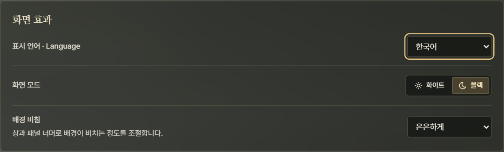

# Elden Ring Mod Assist · Erdtree User Guide

[Project overview](../README.md) · [한국어 설명서](guide.ko.md)

This portable Windows x64 app manages the Steam edition of ELDEN RING. For your first modded session, close the game, register your vanilla installation, back up your vanilla saves, then create a mod profile.

## 1. Open the app in English

1. Download the Windows portable ZIP from the release and choose **Extract All**.
2. Open **Elden Ring Mod Assist - Erdtree.exe** in the extracted folder. Keep the adjacent `me3-0.13.0` folder with the EXE when moving the app. It contains the mod loader. The interface requires the Microsoft Edge WebView2 Runtime.
3. The app opens in Korean the first time. Press `Ctrl+K`, type `language`, press `Enter`, then choose **English**. The change applies immediately. To switch again, open **Settings → Appearance → Display language**.

## 2. Register the game you already have

Close the game. In **Settings → Game Installation**, check that the path ends in your Steam library’s `ELDEN RING\Game`. Use **Find in Steam** to look again, or type the path and select **Connect**.

| Your installation | What to do |
| --- | --- |
| Clean vanilla game | Select **Register Baseline**. The first scan reads the full installation and compares it against Steam’s file lists for your installed DLC and language. |
| Mods already inside the Game folder | Choose **Separate Installed Mods**, name the profile and finish archiving it. The app separates added and changed files. Files that need separate installation are kept in the profile’s `preserved` folder. Select **Verify Files in Steam** and wait for verification and downloads to finish. Then select **Register Recovered Files**. You can undo the initial archive only before Steam rewrites the files. |

Open **Overview** to see the active profile and verification status.

## 3. Set aside a vanilla save

**Switching profiles leaves your live saves in place.** Before playing with mods, open **Save Manager**, choose the Steam account and file format, give the backup a name such as `Vanilla – before mods`, then select **Back Up Selected Files**. Matching `.bak` files are included. For PC `.sl2` and `.co2` saves, character names, levels and playtimes help identify the file. Backup and restore operate on whole files.

## 4. Create, review and launch a mod profile

1. **File mods.** Extract the mod. In **Mod Profiles → Create Profile from Mod Folder**, select the folder containing the mod’s files, such as `regulation.bin` or `parts`. Preserve the author’s folder structure. If the download contains several alternatives, select the folder for the one you want.
2. **me3-compatible DLL mods.** Choose **Create Profile from DLL Mod**, select the mod’s dedicated folder, then select the entry DLL named by its author. Leave configuration files and dependencies together in that folder. Follow the author’s instructions for mods that require their own installer or launcher.
3. **Combine file mods.** Switch to the lightweight profile you want to build on, then add a mod folder. In **Compare Mod Files**, review the **Added**, **Identical** and **Conflicts** tabs. For each conflict, choose the existing or incoming file. Confirm your choices and give the new profile a name. If both mods change `regulation.bin`, combining both sets of edits requires a compatibility patch or a merged file.
4. **Play with mods.** Choose **Switch** on the profile, confirm, then select **Launch Mods**. me3 launches the selected profile with online matchmaking disabled.
5. **Return to official online play.** Close the game and back up any modded progress you want to keep. Choose **Switch to Vanilla**, then check or restore the save you use for vanilla play. Select **Overview → Verify and Launch Vanilla**. If the Game folder passes verification, the app requests a Steam launch. Easy Anti-Cheat and the game servers determine online access.

## 5. Restore a save or take it to another PC

| Task | Steps |
| --- | --- |
| Restore previous progress | Close the game. Check the backup’s **account, format and date**, then choose **Restore → Back Up and Restore**. The app verifies the backup files against their SHA-256 hashes and backs up current supported saves before replacing the files included in the selected backup. They return to their original account folders and filenames. If interrupted, select **Restore on the same backup** to finish. |
| Keep automatic backups | In **Mod Profiles**, enable backups before switching, or turn on scheduled backups in **Save Manager**. Set the check interval to 1–120 minutes and retention to 1–100 backups, then select **Save Backup Settings**. Leave the app open. It also checks while minimized. When retention is exceeded, the oldest scheduled backups are removed first. **Keep Backup** pins a backup. Pinned, manual, pre-switch and pre-restore backups are kept outside this limit. |
| Transfer a backup | Use **Export Backup** and choose a destination. Copy the entire new subfolder to the other PC. There, select **Import Backup** and choose the folder containing `manifest.json`. Import adds a copy to the backup list. When ready to replace the live save, check the recorded account and select **Restore**. |

Profiles live in `.eldenring-mod-assist` beside the game’s `Game` folder. Live saves are in account folders under `%APPDATA%\EldenRing`. Backups are under `%LOCALAPPDATA%\app.eldenring.modassist\save-backups`. You can move the app itself on the same PC and Windows account and still access those records. On another PC, reconnect the game. Backup export transfers the selected save backup. Profiles, journal entries, planner inputs and appearance settings stay on their original device.

## 6. Track a journey and plan a build

- **Adventure Journal → New journey** creates a checklist for a character or playthrough. Mark base-game and DLC Remembrance bosses, Scadutree Fragments and Revered Spirit Ash as you find them. Search unfinished entries, or use **Add goal** to note NPCs or equipment. **Open Korean map** opens a Korean-language map in your default browser.
- **Build Planner** compares the minimum level and rune cost for each starting class to reach the attributes you enter. You can also enter a current level and target level to calculate the runes between them. Journal entries and planner inputs are saved locally.

## 7. Search, appearance and window controls

- Press `Ctrl+K` or `/` to search for a page, feature or profile. Use the arrow keys and `Enter` to select a result, or `Esc` to close search.
- Open **Settings → Appearance** to change language, **Color mode** or **Transparency**. The defaults are Korean, **Dark** and **Subtle**. The sun/moon button also switches between **Light** and **Dark**. Choose **Subtle**, **More transparent** or **Opaque** for the window background. The app remembers these choices.
- Drag the logo or empty space in the top bar to move the window. Double-click there to maximize or restore it. Minimize, maximize/restore and close are at the right edge. The menu button at the left collapses the sidebar.

## Troubleshooting

- **Launch Mods is unavailable.** Check that the game is in a Steam library and that a lightweight mod profile is active. In **Settings → me3 Mod Loader**, use **Auto-Detect** or **Select me3.exe** to locate the loader. A failed launch writes a log to `%LOCALAPPDATA%\app.eldenring.modassist\me3-last-launch.log`.
- **The baseline differs after a Steam update.** Switch to vanilla, verify the files in Steam and wait for downloads to finish. Select **Settings → Register Baseline Again**. Check that your mods support the new game build.
- **A profile switch was interrupted.** Close the game and select **Settings → Recover Switch**.
- **If the window stays opaque**, check the app’s Transparency setting along with Windows transparency and accessibility settings.
