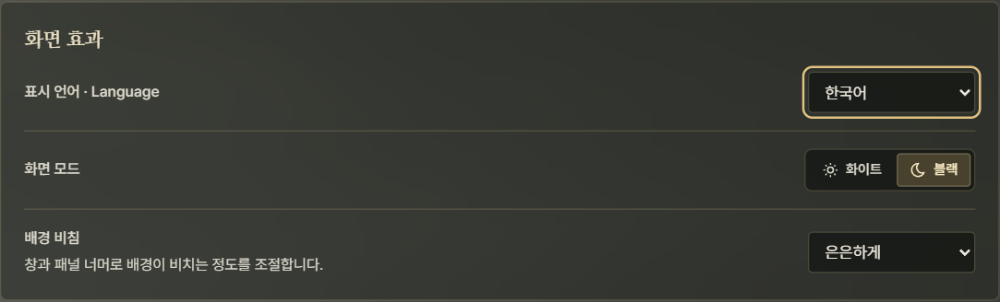

# 엘든 링 모드 어시스트 · 황금나무 사용 설명서

[프로젝트 소개](../README.md) · [English guide](guide.en.md)

Steam판 ELDEN RING을 위한 Windows x64 포터블 앱입니다. 처음 사용한다면 **게임 종료 → 원본 등록 → 바닐라 세이브 백업 → 모드 프로필 만들기** 순서로 시작하세요.

## 1. 앱 열기

1. 릴리스에서 Windows 포터블 ZIP을 받아 **전체 압축 풀기**를 선택하세요.
2. 풀린 폴더에서 **Elden Ring Mod Assist - Erdtree.exe**를 엽니다. 앱을 옮길 때는 EXE 옆의 `me3-0.13.0` 폴더도 함께 옮기세요. 모드 실행에 필요한 로더가 들어 있습니다.
3. 화면을 표시하려면 Microsoft Edge WebView2 런타임이 필요합니다. 영어로 시작하려면 `Ctrl+K`에서 `language`를 검색하고 `Enter`를 누른 뒤 **English**를 고르세요.

## 2. 현재 게임 설치 등록하기

게임을 종료하고 **설치 설정 → 게임 설치 위치**에서 Steam의 `ELDEN RING\Game` 폴더를 확인하세요. 경로를 찾지 못하면 **Steam에서 찾기**를 누르거나, 직접 경로를 입력하고 **연결**을 누르세요.

| 현재 상태 | 진행 방법 |
| --- | --- |
| 깨끗한 바닐라 설치 | **원본 등록**을 누릅니다. 앱이 처음 한 번 게임 파일 전체를 읽어 설치된 DLC와 언어에 해당하는 Steam 원본과 대조합니다. |
| Game 폴더에 모드를 이미 설치함 | **설치된 모드 분리**로 프로필 이름을 정하고 보관을 마칩니다. 추가·변경된 파일만 분리되며, 별도 설치가 필요한 파일은 프로필의 `preserved` 폴더에 남습니다. **Steam 파일 검사** 후 다운로드까지 끝나면 **받은 원본 등록**을 누르세요. 최초 보관 취소는 Steam이 파일을 다시 쓰기 전에만 가능합니다. |

등록을 마치면 **사용 현황**에서 활성 프로필과 검사 상태를 확인할 수 있습니다.

## 3. 바닐라 세이브 보관하기

**프로필 전환은 세이브를 교체하지 않습니다.** 모드 플레이를 시작하기 전에 **세이브 관리**에서 Steam 계정과 파일 형식을 확인하고, `바닐라 · 모드 시작 전`처럼 이름을 붙여 **선택한 파일 백업**을 누르세요. 해당 형식의 `.bak`도 포함됩니다. PC판 `.sl2`와 `.co2`는 캐릭터 이름·레벨·플레이 시간으로 파일을 구분할 수 있습니다. 백업과 복원은 파일 단위로 진행합니다.

## 4. 모드 프로필 만들고 실행하기

1. **파일 모드**는 압축을 풀고 **모드 프로필 → 모드 폴더로 프로필 만들기**를 누르세요. `regulation.bin`이나 `parts` 등 제작자가 지정한 경로를 유지한 폴더를 고릅니다. 옵션이 여럿이면 사용할 옵션 폴더 하나를 선택하세요.
2. **me3 호환 DLL 모드**는 **DLL 모드로 프로필 만들기**에서 해당 모드 전용 폴더를 고른 뒤 제작자가 지정한 진입 DLL을 선택하세요. 설정과 의존 파일은 폴더에 함께 둡니다. 전용 설치기나 자체 실행기가 필요한 모드는 제작자 안내를 따르세요.
3. **기존 조합에 파일 모드를 더하려면** 그 경량 프로필로 먼저 전환한 뒤 모드 폴더를 추가하세요. **모드 파일 비교**에서 추가·동일·충돌 항목을 검토하고, 충돌 경로마다 기존 파일 또는 새 파일을 고릅니다. 확인란을 체크하고 새 이름으로 프로필을 만드세요. 두 모드가 서로 다른 `regulation.bin`을 쓴다면, 양쪽 변경을 모두 적용하려면 호환 패치나 병합 파일이 필요합니다.
4. 원하는 프로필의 **전환**을 확인한 뒤 **모드 실행**을 누르세요. me3가 해당 프로필을 온라인 매칭이 꺼진 상태로 실행합니다.
5. **공식 온라인 플레이로 돌아갈 때**는 게임을 종료하고, 이어갈 모드 세이브를 별도 이름으로 백업하세요. **바닐라로 전환**한 뒤 바닐라용 세이브를 확인하거나 복원하고 **사용 현황 → 바닐라 검사 후 실행**을 누르세요. Game 폴더 검사를 통과하면 Steam에 실행을 요청합니다. 온라인 접속은 EAC와 게임 서버가 판정합니다.

## 5. 세이브 복원과 다른 PC로 이동

| 할 일 | 방법 |
| --- | --- |
| 이전 진행으로 복원 | 게임을 종료하고 백업의 **계정·형식·시점**을 확인한 뒤 **복원 → 백업 후 복원**을 누르세요. 앱은 SHA-256으로 백업 파일을 검사하고 현재 지원 세이브를 먼저 백업한 뒤, 선택한 백업에 든 파일만 원래 계정 폴더와 파일명에 덮어씁니다. 중단되면 **같은 백업**에서 복원을 다시 누르세요. |
| 자동 백업 | **모드 프로필**에서 전환 직전 백업을 설정하거나 **세이브 관리**에서 주기 자동 백업을 켜세요. 확인 간격(1~120분)과 보관 개수(1~100개)를 정하고 **자동 백업 설정 저장**을 누르세요. 앱을 열어 두면 최소화 상태에서도 변경된 세이브를 보관합니다. 한도를 넘으면 오래된 주기 백업부터 정리됩니다. **계속 보관**으로 고정한 백업, 수동 백업, 전환·복원 전 백업은 유지됩니다. |
| 다른 PC로 세이브 옮기기 | **백업 내보내기**로 대상 폴더를 선택하세요. 만들어진 하위 폴더 전체를 옮기고, 새 PC에서 **백업 가져오기**를 눌러 `manifest.json`이 들어 있는 폴더를 고릅니다. 가져오면 백업 목록에 추가됩니다. 실제 세이브에 쓰려는 시점에 계정을 확인하고 **복원**하세요. |

프로필은 게임의 `Game` 옆 `.eldenring-mod-assist`에, 현재 세이브는 `%APPDATA%\EldenRing` 아래 계정별 폴더에, 백업은 `%LOCALAPPDATA%\app.eldenring.modassist\save-backups`에 있습니다. 앱 폴더만 옮기면 같은 PC·Windows 계정에서는 기존 데이터를 계속 읽습니다. 다른 PC에서는 게임을 다시 연결하세요. 백업 내보내기에 포함되는 것은 해당 세이브 백업이며, 프로필·수첩·계산기 입력·화면 설정은 각 기기에 남습니다.

## 6. 모험 기록과 빌드 계획

- **모험 수첩 → 새 여정**에서 캐릭터와 회차별로 이름을 정하세요. 본편·DLC 추억 보스, 그림자 나무 파편, 영혼 재의 진행을 직접 표시할 수 있습니다. 남은 항목을 검색하거나 **목표 추가**로 NPC와 장비를 기록하세요. **한글 지도 열기**는 기본 브라우저에서 지도를 엽니다.
- **빌드 계산기**에서 목표로 삼은 능력치만 입력하면 태생별 최소 레벨과 필요한 룬을 비교할 수 있습니다. 현재·목표 레벨을 입력하면 해당 구간의 룬 비용도 확인할 수 있습니다. 수첩과 계산기 입력은 현재 기기에 저장됩니다.

## 7. 화면과 단축키

- **검색**은 `Ctrl+K` 또는 `/`로 열고, 메뉴·기능·프로필 이름을 입력하세요. 방향키와 `Enter`로 선택하고 `Esc`로 닫습니다.
- **언어와 테마**는 **설치 설정 → 화면 효과**에서 고릅니다. 기본값은 한국어·블랙·**은은하게**입니다. 상단 해·달 버튼으로 화이트와 블랙을 바로 바꿀 수 있습니다. **배경 비침**은 **은은하게 / 더 선명하게 / 불투명** 중 선택하세요. 선택은 다음 실행에도 유지됩니다.
- **창 조작**은 상단 로고나 빈 공간을 끌어 이동하고 두 번 클릭해 최대화·복원하세요. 오른쪽 끝에는 최소화·최대화·닫기가, 왼쪽에는 사이드바 접기 버튼이 있습니다.

## 문제가 생겼을 때

- **모드 실행 버튼을 쓸 수 없다면** Steam 라이브러리의 게임 폴더와 활성 경량 프로필을 확인하세요. **설치 설정 → me3 모드 로더 → 자동 찾기**를 누르거나 **me3.exe 선택**으로 로더를 지정하세요. 실행 실패 기록은 `%LOCALAPPDATA%\app.eldenring.modassist\me3-last-launch.log`에 있습니다.
- **Steam 업데이트 후 빌드가 다르다고 나오면** 바닐라로 전환해 Steam 파일 검사와 다운로드를 마치고 **설치 설정 → 원본 다시 등록**을 누르세요. 모드도 새 게임 빌드와 호환되는지 확인하세요.
- **프로필 전환이 중단됐다면** 게임을 종료하고 **설치 설정 → 전환 복구**를 누르세요.
- **창이 계속 불투명하다면** 앱의 배경 비침과 Windows 투명 효과·접근성 설정을 함께 확인하세요.
